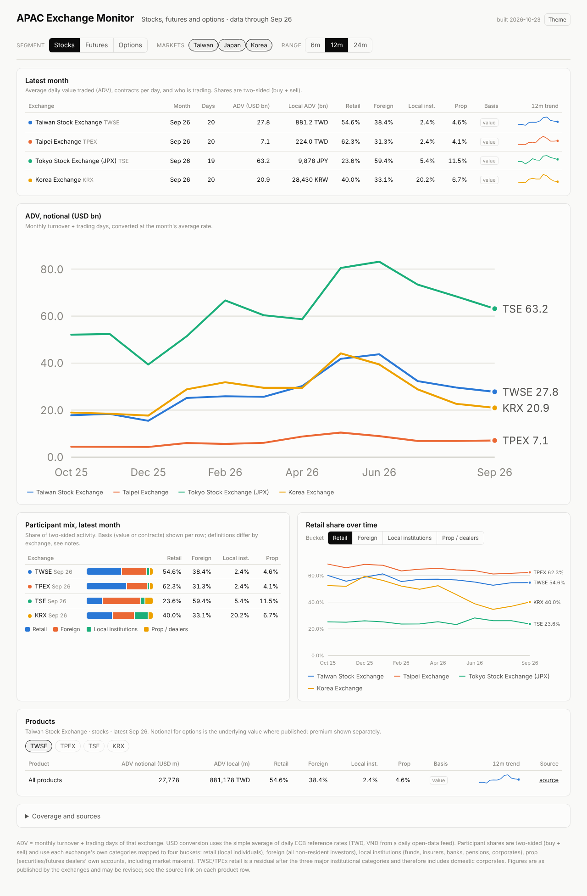

# APAC Exchange Monitor

Monthly monitor of trading activity across APAC stock, futures and options exchanges:
average daily value traded (notional, local and USD), contracts per day for
derivatives, and the participant mix (retail / foreign / local institutions / prop)
where the exchange publishes it. Twelve-plus months of history, line charts, a
latest-month table, per-product detail, and a link back to the source for every number.

Runs entirely on GitHub: a scheduled Action collects the previous month's figures
around the 15th, validates them, commits the CSV, and GitHub Pages serves the
dashboard (`index.html` + `data.json`) straight from the repository root.



Everything lives in one flat folder on purpose, so the repo can be uploaded through
the GitHub website without worrying about folder structure. The only folder GitHub
insists on is `.github/workflows/` for the automation, which is created with a
one-file move (see setup step 4).

## Status

| Market | Venues | Collection | Participant mix |
|---|---|---|---|
| Taiwan | TWSE, TPEx, TAIFEX | automated | monthly (TWSE/TPEx by value, TAIFEX by contracts) |
| Japan | TSE, OSE (JPX) | automated | monthly (by value; derivatives also by contracts) |
| Korea | KRX | automated | monthly (stocks by value, futures by contracts; no all-options split) |
| Hong Kong | HKEX | manual CSV | annual derivatives survey only |
| China | SSE, SZSE, BSE, CFFEX, SHFE/INE, DCE, CZCE, GFEX | manual CSV | not published monthly |
| Australia | ASX, ASX 24, Cboe Australia | manual CSV | not published |
| Thailand | SET, TFEX | automated | monthly (SET by value from its monthly market report; TFEX three-way split by contracts, prop inside local institutions) |
| Vietnam | HOSE, HNX | manual CSV | foreign vs domestic; HNX derivatives individual/institutional |
| India | NSE, BSE, MCX, NCDEX | manual CSV | monthly (NSE category-wise participation) |
| Singapore | SGX | manual CSV | not published |
| Malaysia | Bursa Malaysia | manual CSV | monthly for equities |

"Manual CSV" venues appear on the dashboard as soon as rows for them are added in a
`manual_*.csv` file (see `MANUAL_ENTRY.md`); writing a collector for them is the
natural next step. `venues.csv` is the registry and carries notes on where each
venue's figures live.

## Setting it up (website only, no command line)

1. Create a new **public** repository on GitHub (no README).
2. Click **uploading an existing file**, drag every file from this folder onto the
   page, and **Commit changes**. The repo ships with 12 months of data, so the page
   is populated from the first upload.
3. **Settings → Pages**: Source = *Deploy from a branch*, branch `main`, folder
   **/ (root)**, Save. The dashboard will be at `https://<user>.github.io/<repo>/`.
   (`.nojekyll` is included so GitHub serves the HTML as-is.)
4. Put the automation in the folder GitHub requires: open `monthly.yml` in the repo,
   click the pencil (Edit), and in the filename box change `monthly.yml` to
   `.github/workflows/monthly.yml`. Commit. GitHub creates the folders for you.
   Optionally do the same for `validate.yml`.
5. **Settings → Actions → General → Workflow permissions**: *Read and write
   permissions*, Save, so the monthly job can commit data.
6. Optionally **Actions → Monthly update → Run workflow** to confirm the collectors
   run from GitHub's servers (no secrets needed; takes 5–10 minutes).

## Local run

```bash
pip install -r requirements.txt
MONTHS=13 python collect.py      # run collectors, merge manual_*.csv -> observations.csv
python fx.py                      # monthly average FX -> fx_monthly.csv
python validate.py                # schema + sanity checks (non-zero exit on hard errors)
python build.py                   # -> data.json and summary_latest.csv
python -m http.server 8000        # open http://localhost:8000
```

`ONLY=tw,jp` limits collection to specific collectors; `ONLY=none` only merges the
manual CSVs. Raw downloads are cached in `raw/` (git-ignored) so re-runs are fast.

## Files

```
index.html         the dashboard (vanilla JS + inline SVG, no build step, light/dark)
data.json          generated by build.py; what the dashboard reads
screenshot.png     README image

tw.py, jp.py, kr.py, th.py   collectors, one per market (common.py = shared helpers + row schema)
collect.py         runs collectors, merges manual_*.csv, writes observations.csv
fx.py              monthly average USD rates (ECB via frankfurter.app; TWD/VND via currency-api)
validate.py        schema and sanity checks
build.py           compiles data.json and summary_latest.csv

venues.csv         registry of all venues (country, segments, currency, collector, notes)
observations.csv   the tidy dataset - one row per month x venue x segment x product x metric
fx_monthly.csv     month x currency -> units per USD
summary_latest.csv latest-month table (ADV, shares) for quick reading on GitHub
manual_template.csv, MANUAL_ENTRY.md   how to add hand-entered numbers

monthly.yml        GitHub Action: cron 15th 02:00 UTC: collect -> fx -> validate -> build -> commit
validate.yml       GitHub Action: on push, merge manual CSVs, validate, build
                   (both must be moved to .github/workflows/ - setup step 4)
```

## Data schema

`observations.csv` is long/tidy. Key = (month, exchange, segment, product, metric, basis).

| column | meaning |
|---|---|
| `month` | `YYYY-MM` |
| `country` | ISO-2: CN HK JP TW KR AU TH VN IN SG MY |
| `exchange` | venue code from `venues.csv` |
| `segment` | `stocks` / `futures` / `options` |
| `product` | `ALL` for the whole segment, else a product-group code (`TX`, `NK225F`, `KOSPI200O`, …) |
| `metric` | `turnover_notional`, `turnover_premium`, `contracts`, `trading_days`, `share_retail`, `share_foreign`, `share_local_inst`, `share_prop` |
| `basis` | for `share_*` only: `value` / `contracts` / `premium` - what the share is measured on |
| `value` | base currency units (not millions), counts, or 0-1 fractions |
| `currency` | ISO code for `turnover_*` rows |
| `source` | URL of the page or file the number was taken from |
| `method` | `auto` / `manual` |
| `collected_at` | date the row was produced |

Derived by `build.py`: `adv_* = turnover / trading_days`, USD at the month's average
rate. Trading days come from the same exchange and segment (product `ALL`).

### Definitions worth knowing

- **Shares are two-sided** (buy + sell) and use each exchange's own categories mapped
  to four buckets. *Prop* is a separate bucket because dealers/market makers are a
  large, separately reported group on TAIFEX, KRX, OSE, SET and NSE. The mapping per
  exchange is documented at the top of each collector.
- **TWSE/TPEx retail is a residual** (total minus foreign, investment trust and
  dealers), so it includes domestic corporates and other juridical persons.
- **Options "notional"** is the underlying value where the exchange publishes it
  (TAIFEX). OSE and KRX publish premium turnover only, so the options chart uses
  premium ADV for all venues and notional appears in the tables where available.
  India (when added) publishes both; store both.
- **Contract counts are not comparable across exchanges** (multipliers differ; KRX
  counts a spread trade as two contracts). Compare trends, not levels.
- **JPX derivatives investor data is weekly**, assigned to months by reporting week,
  so a month's survey total does not equal exchange volume; shares are unaffected.
- **Revisions**: exchanges occasionally restate. The monthly job re-collects the
  trailing three months, so restatements within that window are picked up.

## Sources used by the automated collectors

| Venue | What | Where |
|---|---|---|
| TWSE | daily market value & days | `twse.com.tw/rwd/zh/afterTrading/FMTQIK` (JSON, per month) |
| TWSE | three major institutional investors, monthly | `twse.com.tw/rwd/zh/fund/BFI82U?type=month` |
| TPEx | monthly value by security type; institutional summary | `tpex.org.tw/www/en-us/afterTrading/marketStats`, `insti/summary` |
| TAIFEX | volume by participant type and product category, monthly | `taifex.com.tw/enl/eng7/tradingVolume` |
| TAIFEX | monthly trading value per product (TWD m) | `taifex.com.tw/enl/eng7/contractMonthDataDown` |
| TAIFEX | daily per-contract volume (TX, MTX, TMF, TXO) | `taifex.com.tw/enl/eng3/futDataDown`, `optDataDown` |
| TSE | monthly statistics report (PDF), domestic common stocks all markets | `jpx.co.jp/english/markets/statistics-equities/monthly/` |
| TSE | trading by type of investors (Excel) | `jpx.co.jp/english/markets/statistics-equities/investor-type/` |
| OSE | trading volume & value by product (Excel) | `jpx.co.jp/english/markets/statistics-derivatives/trading-volume/` |
| OSE | trading by type of investors, derivatives (CSV) | `jpx.co.jp/english/markets/statistics-derivatives/sector/` |
| KRX | stocks by investor type | `data.krx.co.kr` outer-loader screen MDCSTAT022 (no login) |
| KRX | derivatives by product and investor type | KOSIS statId 1976006 (KRX's official monthly filing), tables S0092-S0182 |
| SET | monthly ADT and investor-type shares (SET + mai) | SET "Market Report for <Month>" press release (set.or.th blocks scripts; read via its verbatim republication on mondovisione.com) |
| TFEX | monthly contracts by product, investor type, trading days | `media.tfex.co.th/.../TFEXMonthlyReport_{YYYY}_{Month}.pdf`; fallback `tfex.co.th/api/set/tfex/historical-statistics/monthly` |
| FX | daily USD rates, averaged | `api.frankfurter.app` (ECB); `cdn.jsdelivr.net/npm/@fawazahmed0/currency-api` for TWD/VND |

Known fragilities: TWSE's WAF throttles bursts (the collector paces at 6 s and backs
off); TAIFEX intermittently returns HTTP 520 (retried); KRX's main portal now requires
login, which is why the stock data goes through the public embed and derivatives
through KOSIS; JPX changes file layouts occasionally (two layouts already handled for
both equity and derivatives investor files).

## Adding a collector

Create `<xx>.py` with

```python
VENUES = ["HKEX"]
def collect(months: list[str]) -> list[dict]: ...
```

returning rows built with `common.row(...)` (see the schema in `common.py`), then set
`collector=xx` and `status=auto` for that venue in `venues.csv`. A collector must
never raise for a single bad month - log and continue - and should cache raw
downloads under `raw/<xx>/`. Run `python validate.py` before committing.

Good next candidates: HKEX (monthly statistics are downloadable Excel files), NSE
(publishes investor-type tables monthly), SGX (monthly statistics Excel).

## Manual entries and corrections

See `MANUAL_ENTRY.md`. Any `manual_*.csv` is merged on every run and takes precedence
over automated rows with the same key, which also makes it the place to override a
collector that got something wrong.
